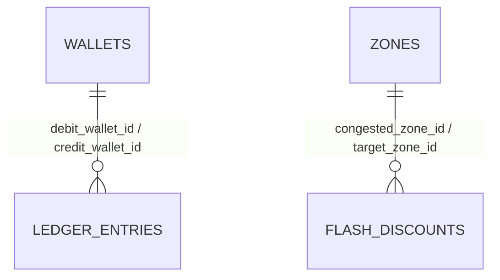

# Database Entity-Relationship Diagram & Constraints

**Assigned Role:** Database Engineer  
**Related Issues:** `ISS-04` (Sprint 1), `ISS-10` (Sprint 2), `ISS-21` (Sprint 3)  
**SQL Files:** [`database/schema.sql`](schema.sql), [`database/seed.sql`](seed.sql)

---

## 1. Entity-Relationship Diagram (`TODO: ISS-04`)
> **Task for Database Engineer (`ISS-04` Pull Request):**
> Expand the Mermaid ER diagram below with all attributes and keys (`PK`, `FK`, `UK`) from `database/schema.sql`, and expand `database/seed.sql` with all initial venue bars, zones, and test attendee wallets.

---

## 2. Double-Entry & Idempotency Constraints (`TODO: ISS-10` & `ISS-21`)
- **Defined in `database/schema.sql`:**
  - `ledger_entries.idempotency_key` enforces `UNIQUE` to guarantee idempotent batch retries.
  - `wallets.balance` enforces `CHECK (balance >= 0.00)` and `ledger_entries.amount` enforces `CHECK (amount > 0.00)`.
- **Remaining for `ISS-21`:** Add composite performance indexes and the `v_ledger_reconciliation` SQL view (`SUM(debit) == SUM(credit)`).
