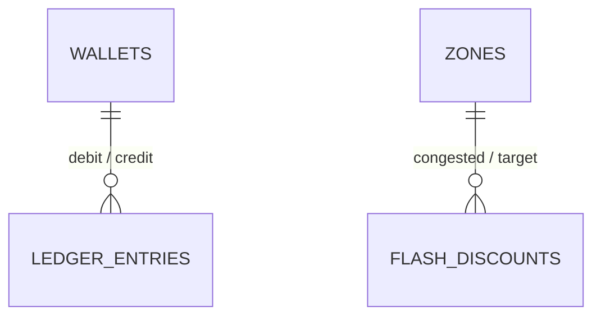

# Database Entity-Relationship Diagram & Constraints (Skeleton)

**Assigned Role:** Database Engineer  
**Related Issues:** `ISS-04` (Sprint 1), `ISS-10` (Sprint 2), `ISS-21` (Sprint 3)  
**SQL Files:** `database/schema.sql`, `database/seed.sql`

---

## 1. Entity-Relationship Diagram (`TODO: ISS-04`)
> **Task for Database Engineer (`ISS-04` Pull Request):**
> Expand the Mermaid ER diagram below to include all columns, types, Primary Keys (`PK`), Foreign Keys (`FK`), and Unique Keys (`UK`) for `WALLETS`, `LEDGER_ENTRIES`, `ZONES`, and `FLASH_DISCOUNTS`.

---

## 2. Double-Entry & Idempotency Constraints (`TODO: ISS-10` & `ISS-21`)
> **Task for Database Engineer:**
> Document the `UNIQUE(idempotency_key)` constraint, transaction isolation level, and index strategy.
