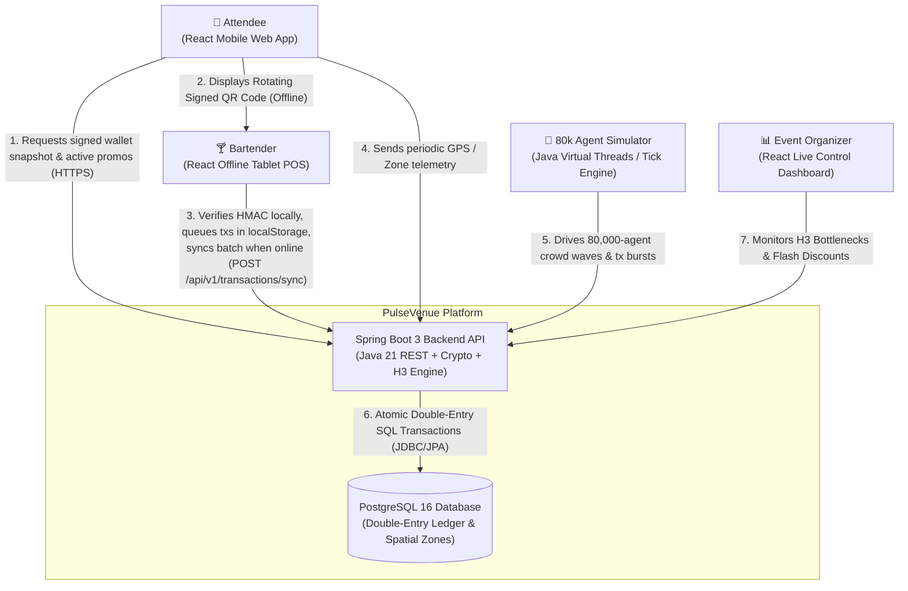
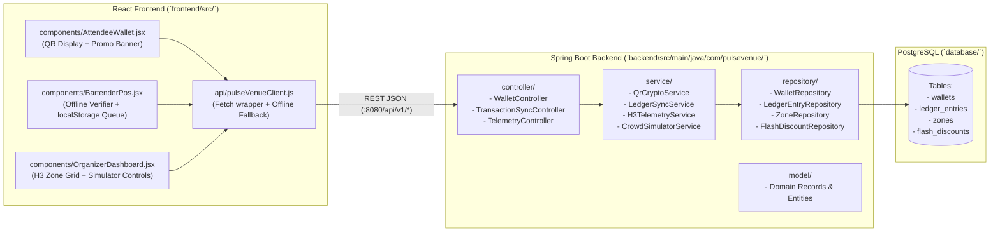
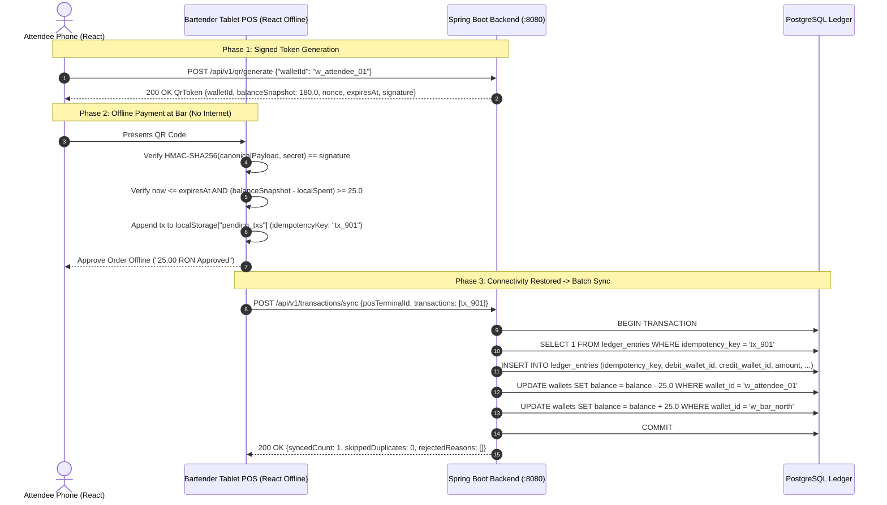
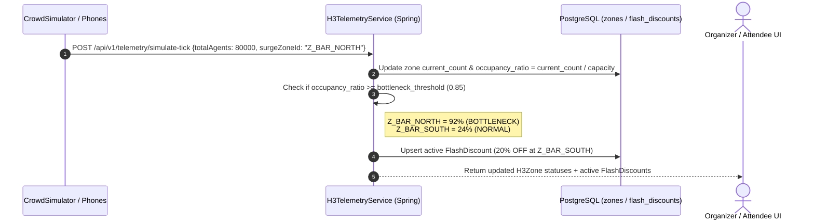

# Software Architecture — Technical Structure, Diagrams & API Contracts

**Completed Role:** Software Architect (`ISS-03`)  
**Tech Stack:** Java 21 (JDK `HttpServer` MVP → Spring Boot 3.3 target) · React 18 (Vite) · PostgreSQL 16  
**Project:** PulseVenue — Offline-First Event Operations & Cashless Commerce Platform

---

## 1. Architectural Simplification Strategy ("Barebone MVP First, Heavy Later")

To enable a team of 7 students to get a working end-to-end system in Sprint 1–2 before tackling complex distributed/spatial features:

| Subsystem | Barebone MVP (Sprint 1–2) | Heavy / Stretch Phase (Sprint 3–4) |
| :--- | :--- | :--- |
| **1. Rotating Signed QR** | Standard `javax.crypto.Mac` (`HmacSHA256`) signed JSON payload (`walletId`, `balanceSnapshot`, `nonce`, `expiresAt`, `signature`) + "Paste / Simulate Scan" input on POS | Asymmetric Ed25519/ECDSA keypairs + live WebRTC camera QR scanner (`html5-qrcode`) |
| **2. Offline POS Queue** | Browser `localStorage` array of `OfflineTransaction` objects + manual/auto batch POST to `/api/v1/transactions/sync` | IndexedDB + Service Worker PWA full offline caching |
| **3. Double-Entry Ledger** | 3 core PostgreSQL tables (`wallets`, `ledger_entries` with `UNIQUE(idempotency_key)`, `zones`) managed via Spring `@Transactional` | Optimistic locking (`@Version`), ledger audit snapshots & reconciliation jobs |
| **4. Uber H3 Telemetry & Flash Promos** | Pre-defined H3 Zone buckets (`Z_STAGE_MAIN`, `Z_BAR_NORTH`, `Z_BAR_SOUTH`, etc.); if `currentCount / capacity >= 0.85`, trigger 20% discount at nearest `NORMAL` bar | Uber `h3-java` library mapping raw GPS `(lat, lng)` coordinates to Res-10 hexagons + interactive map overlay |
| **5. 80,000-Agent Simulator** | Tick-based Java service (`CrowdSimulatorService`) updating zone headcount vectors and generating synthetic batch transactions | Multi-threaded virtual-thread (`Executors.newVirtualThreadPerTaskExecutor()`) agent runner with live WebSocket push |

---

## 2. C4 Level 1 — System Context Diagram



---

## 3. C4 Level 2 — Container & Package Diagram (Java + React + PostgreSQL)



---

## 4. C4 Level 3 — Sequence Diagrams

### 4.1 Offline QR Payment & Deferred Double-Entry Batch Sync



### 4.2 Crowd Bottleneck Detection & Geofenced Flash Discount Flow



---

## 5. REST API Contracts (Freeze v1 for Frontend & Backend Parallel Work)

> **Current MVP Implementation Note:** [`PulseVenueApplication.java`](../../backend/src/main/java/com/pulsevenue/PulseVenueApplication.java) implements all 6 endpoints below using JDK `HttpServer` and in-memory state in [`PulseVenueService.java`](../../backend/src/main/java/com/pulsevenue/service/PulseVenueService.java). Where the current MVP payload is simplified compared to the target v1 contract, both are noted below.

### `GET /api/v1/health`
```json
{ "status": "UP", "service": "pulsevenue-backend", "wallets": 2 }
```

### `GET /api/v1/state`
- **Target Full Contract:**
```json
{
  "wallets": [
    { "walletId": "w_attendee_01", "ownerName": "Alex Popescu", "role": "ATTENDEE", "balance": 180.00, "currency": "RON" }
  ],
  "recentLedger": [],
  "zones": [
    {
      "zoneId": "Z_BAR_NORTH",
      "h3Index": "8a2a1072b51ffff",
      "name": "North Main Bar",
      "zoneType": "BAR",
      "capacity": 15000,
      "currentCount": 13800,
      "bottleneckThreshold": 0.85,
      "status": "BOTTLENECK",
      "occupancyRatio": 0.92
    }
  ],
  "activeDiscounts": [
    {
      "discountId": "disc_Z_BAR_NORTH_to_Z_BAR_SOUTH",
      "congestedZoneId": "Z_BAR_NORTH",
      "targetZoneId": "Z_BAR_SOUTH",
      "discountPercent": 20,
      "promoMessage": "Crowd Alert at North Main Bar (92% full)! Head to South Chill Bar for 20% OFF!"
    }
  ],
  "totalAttendeesTracked": 80000
}
```
- **Current MVP Summary Response:** `{ "status": "ACTIVE", "walletsCount": 2, "zonesCount": 3 }`

### `POST /api/v1/qr/generate`
- **Request:** `{ "walletId": "w_attendee_01", "ttlSeconds": 300 }`
- **Response:**
```json
{
  "walletId": "w_attendee_01",
  "ownerName": "Alex Popescu (Attendee)",
  "balanceSnapshot": 180.00,
  "currency": "RON",
  "nonce": "9f8e7d6c",
  "issuedAt": 1762250000,
  "expiresAt": 1762250300,
  "signature": "e4d909c290d0fb1ca068ffaddf22cbd0..."
}
```

### `POST /api/v1/qr/verify-offline`
- **Request:** `{ "walletId": "w_attendee_01", "ownerName": "Alex Popescu (Attendee)", "balanceSnapshot": 180.00, "currency": "RON", "nonce": "9f8e7d6c", "issuedAt": 1762250000, "expiresAt": 1762250300, "signature": "...", "orderAmount": 25.00, "localAlreadySpent": 0.00 }`
- **Response:** `{ "valid": true, "reason": "Offline verification successful", "remainingOfflineBalance": 155.00 }`

### `POST /api/v1/transactions/sync`
- **Request:**
```json
{
  "posTerminalId": "POS_BAR_NORTH_01",
  "transactions": [
    {
      "idempotencyKey": "tx_pos01_1762250015_001",
      "debitWalletId": "w_attendee_01",
      "creditWalletId": "w_bar_north",
      "amount": 25.00,
      "createdOfflineAt": 1762250015
    }
  ]
}
```
- **Response:**
```json
{
  "posTerminalId": "POS_BAR_NORTH_01",
  "syncedCount": 1,
  "skippedDuplicates": 0,
  "rejectedReasons": []
}
```

### `POST /api/v1/telemetry/simulate-tick`
- **Current MVP Request:** Map of H3 index (`8a2a...`) to updated headcount, e.g. `{ "8a2a1072b51ffff": 14000 }`
- **Response:** `{ "status": "processed", "activeDiscountsCount": 1, "discounts": [...] }`

---

## 6. Architecture Decision Records (ADRs)

- **ADR-001 (Canonical QR Signature String):** To guarantee identical HMAC-SHA256 hashes between Java 21 (`javax.crypto.Mac`) and browser JavaScript (`SubtleCrypto` / POS verifier), the signed message format is:
  `walletId|balanceSnapshot(2 decimals)|currency|nonce|issuedAt|expiresAt`. *(Note: current `PulseVenueService.java` formats decimals with `Locale.GERMANY` (`180,00`); align to `Locale.US` / dot separator before enabling client-side `SubtleCrypto` verification.)*
- **ADR-002 (Idempotent Double-Entry Settlement):** All offline POS tablets generate a UUID/unique `idempotencyKey` per transaction at scan time. The database enforces `UNIQUE(idempotency_key)` on `ledger_entries` so network retries never double-charge an attendee.
- **ADR-003 (Phased Spatial & Simulation Complexity):** Sprint 1–2 uses named H3 hex zones (`Z_STAGE_MAIN`, etc.) and vectorized headcounts so the 7-person team can complete the core loop quickly; Sprint 3–4 swaps in `com.uber:h3` coordinate indexing and Java 21 virtual threads for the 80,000-agent simulator.
