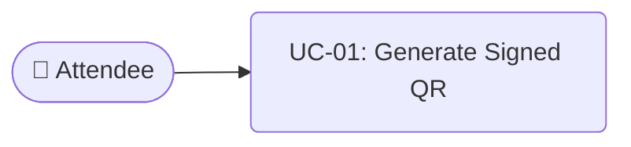

# Business Analysis — Requirements, Use Cases & Activity Diagrams (Skeleton)

**Assigned Role:** Business Analyst (BA)  
**Related Issues:** `ISS-02` (Sprint 1), `ISS-15` (Sprint 2), `ISS-26` (Sprint 4)

---

## 1. Actors (Baseline Scope)
- **Attendee:** Uses the React mobile web app to display a rotating signed QR code and receive geofenced flash discount alerts.
- **Bartender / POS Operator:** Uses a tablet in offline/low-connectivity mode to scan QR codes, verify signatures locally, queue transactions, and sync batches.
- **Event Organizer:** Monitors Uber H3 zone crowd occupancy and bottleneck alerts.
- **80k Agent Simulator:** Stress-tests crowd movement and payment batches.

---

## 2. Functional & Non-Functional Requirements (`TODO: ISS-02`)
> **Task for BA (`ISS-02` Pull Request):**
> Expand the table below with detailed user stories and acceptance criteria for `FR-01` through `FR-10` and `NFR-01` through `NFR-05`.

| ID | Category | Summary | Acceptance Criteria (`TODO: ISS-02`) |
| :--- | :--- | :--- | :--- |
| **FR-01** | Wallet & QR | Rotating HMAC-SHA256 QR generation | *TODO: Define rotation interval & required fields* |
| **FR-02** | Offline POS | Local signature & balance verification | *TODO: Define offline spend limit & expiration rules* |
| **FR-03** | Cloud Ledger | Batch sync to double-entry ledger | *TODO: Define idempotency & conflict rules* |
| **FR-04** | H3 Telemetry | Bottleneck detection (`>= 85%`) & Flash Discounts | *TODO: Define discount trigger & cooldown rules* |

---

## 3. UML Use Case Diagram (`TODO: ISS-02`)
> **Task for BA (`ISS-02` Pull Request):** Add the Mermaid Use Case diagram mapping all 4 actors to their system use cases.

---

## 4. UML Activity Diagrams (`TODO: ISS-15`)
> **Task for BA (`ISS-15` Pull Request):** Create two swimlane Activity Diagrams:
> 1. **Flow A:** Offline QR Scan -> Local HMAC Verification -> `localStorage` Queue -> Batch Sync to Double-Entry Ledger.
> 2. **Flow B:** GPS Telemetry -> Uber H3 Zone Aggregation -> Bottleneck Detection -> Geofenced Flash Discount Broadcast.

---

## 5. Requirements Traceability Matrix (`TODO: ISS-26`)
> **Task for BA (`ISS-26` Pull Request):** Map each `FR-xx` to its Java service method, React component, and QA test case (`TC-xx`).
