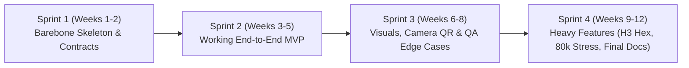

# PulseVenue — Barebone Simplification & Phased Roadmap

> **Philosophy:** Get a working end-to-end vertical slice running in **Week 1–2** using minimal, standard-library / lightweight code so all 7 team members can work in parallel without blocking each other. Only add complex cryptography, real H3 geospatial bindings, camera hardware scanning, and 80k-agent stress loads **after** the barebone loop works.

---

## 1. How We Simplify Each Subsystem ("Barebone First, Heavy Later")

| Subsystem | Original "Heavy" Concept | Barebone Working MVP (Build First) | Phase 2 / Stretch Upgrade (Add Later) |
| :--- | :--- | :--- | :--- |
| **1. Rotating Signed QR Payments** | Asymmetric Ed25519 keys in WebCrypto + QR canvas animation + camera WebRTC scanner | **HMAC-SHA256 signed JSON token** (`user_id`, `balance`, `nonce`, `exp`) rendered as text/SVG QR + **"Simulate Scan / Paste Token"** button on Bartender view | Real HTML5 camera QR reader (`html5-qrcode`) + asymmetric ECDSA/Ed25519 keypairs per device |
| **2. Offline Bartender POS & Batch Sync** | IndexedDB + Service Worker PWA + CRDT conflict resolution | **`localStorage` offline queue** (`pending_txs[]`) + Online/Offline toggle button in UI + single `POST /api/transactions/sync` batch endpoint | Service Worker full offline caching + IndexedDB storage + automatic background sync on `navigator.onLine` |
| **3. Double-Entry Cloud Ledger** | Distributed event-sourced banking engine with multi-node consensus | **SQLite / PostgreSQL with 3 core tables**: `wallets`, `ledger_entries` (`debit_wallet`, `credit_wallet`, `amount`, `idempotency_key`), `users` | PostgreSQL serializable transactions, audit trail exports, over-draft reconciliation alerts |
| **4. Uber H3 Crowd Telemetry & Flash Discounts** | Real-time mobile GPS streaming -> Uber H3 hexagonal C-bindings -> spatial clustering | **6 named H3-style Zone IDs** (`H3_STAGE_MAIN`, `H3_BAR_NORTH`, `H3_BAR_SOUTH`, etc.) + simple rule: if `count > capacity * 0.85`, trigger a 20% discount at the nearest under-loaded bar | `h3-py` / `h3-js` hexagonal indexing from real `(lat, lng)` coordinates + Leaflet/Mapbox hex heatmap |
| **5. 80,000-Agent Simulator** | 80,000 autonomous coroutine agents with continuous pathfinding physics | **Tick-based Python script (`simulator/sim_engine.py`)** simulating either 100 individual agents OR vectorized zone populations (scaling to 80,000 in `<50ms` per tick) hitting the REST API | WebSocket live streaming, custom stage schedule attraction weights, visual particle simulation |

---

## 2. 4-Sprint Delivery Plan (7 Team Members)

### Sprint 1: Barebone Skeleton & Contracts (Current State — Initialized)
- **Goal:** Repo initialized, CI/CD green, DB schema defined, API endpoints stubbed and tested, basic 3-tab UI wired up, BA/Architect diagrams drafted.
- **Deliverable:** Anyone can clone the repo, run `python3 -m unittest discover -s backend/tests`, start the backend, and execute an offline-to-online payment + crowd bottleneck trigger.

### Sprint 2: Core Working MVP
- **Goal:** Connect Frontend <-> Backend <-> SQLite/Postgres Database with real HTTP calls, `localStorage` offline queue, idempotency protection against double-sync, and rule-based flash discount generation.

### Sprint 3: Real UX, Camera QR & QA Verification
- **Goal:** Add real QR code visual rendering & camera scanning fallback, interactive zone map on the Organizer dashboard, UI theme polish from UI Designer, and automated QA test suite covering double-spend and offline recovery.

### Sprint 4: "Heavy" Features & Final Presentation
- **Goal:** Upgrade zone buckets to real Uber H3 hex indexes, run the 80,000-agent vectorized load test with metrics capture, finalize Technical Writer & BA/Architect documentation for grading.
